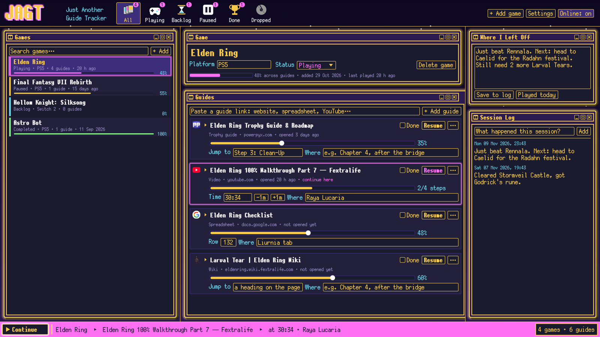

# JAGT — Just Another Guide Tracker

Keep your place in every video game guide, so you're never lost when you come back to a game.

JAGT is a small desktop app written in Rust. Add a game, paste links to the guides you use
(websites, spreadsheets, YouTube videos, wikis, trophy guides and maps), and record where you are
in each one. Next time, press **Continue** to reopen the guide you were using at the spot you
saved. It uses the same look as [JAMP](https://github.com/The1Azreen/Just-Another-Music-Player).



## How it remembers your place

| Guide type | What it saves | What **Resume** does |
|---|---|---|
| **YouTube** | The timestamp (`1:02:03`, `62:03` or `1h2m3s`) | Opens the video at that time |
| **Google Sheets** | The row number | Opens the sheet scrolled to that row |
| **Web pages** (guides, wikis, trophy guides) | A "jump to" phrase, such as a heading | Scrolls the page to that text (Chrome, Edge, Firefox 131+ and Safari) |
| **Everything** | A "where I am" note, progress %, a checklist and notes | |

If you paste a link that already has `&t=95s` or `#range=A40` in it, JAGT keeps that spot.

## Features

- **Games** sorted by status (Playing, Backlog, Paused, Done, Dropped), with progress and when you last played.
- **Guides** are typed automatically from the link. The real page title and site icon are looked up for you.
- **Checklists**: a full-size Checklist window under the guides. Paste a guide's text and JAGT
  splits it into areas (with their own counts, foldable), and items: chests, objectives,
  achievements, quests. Each item keeps its requirement, **How** and **Reward**. A plain list
  (one item per line) works too.
  - Filter by type, hide finished items, search, and **Go to next** to jump to the next unticked item.
  - **Find in guide** opens the guide page scrolled to that item.
  - Resume follows the checklist: it opens the guide at your next unticked item.
- **Suspended tabs**: links from tab-suspender extensions (`chrome-extension://…/suspended.html#…&uri=…`)
  are unwrapped to the real page, keeping its title. Paste several links at once to add them all.
- **Where I Left Off**: a note per game for "what was I about to do?", plus a dated **Session Log**.
- **Continue** (or <kbd>Enter</kbd>): reopens the last guide you used at your saved spot.
- **Paste anywhere**: <kbd>Ctrl</kbd>+<kbd>V</kbd> with a link copied adds it to the current game.
- **Online: off** stops all network use. Icons that are already cached still show.

## Your data

Everything is saved automatically to `library.json`:

- Windows: `%APPDATA%\JAGT\library.json`
- Built and run from this repo (`cargo run`): `jagt-data/library.json` in the repo, which is gitignored
- Portable mode: put a `jagt-data` folder next to the `.exe` (or put "portable" in the exe's name)

The previous version is kept as `library.bak.json`. Settings also has **Export** and **Import**,
which add the games from another library to this one.

## Building

```sh
cargo run --release
```

Requires a recent stable Rust. The release build is a single `.exe` with no runtime to install.

## Credits

- Pixel font: [PixelMplus12](https://itouhiro.hatenablog.com/entry/20130602/font) (M+ FONT LICENSE, see `assets/fonts`)
- Site icons: Google's favicon service
- Look: [the1azreen.neocities.org](https://the1azreen.neocities.org/), shared with JAMP
