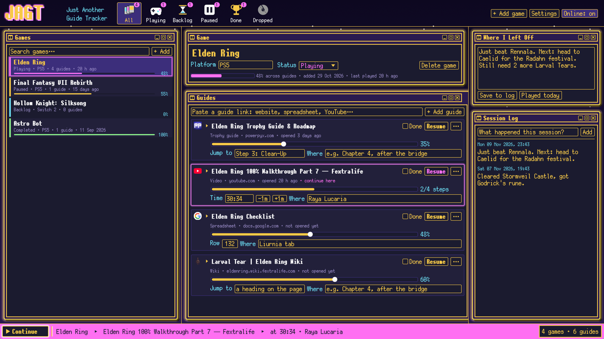

# JAGT — Just Another Guide Tracker

Keep your place in every video game guide, so you're never lost when you come back to a game.

JAGT is a small desktop app written in Rust. Add a game, paste links to the guides you use
(websites, spreadsheets, YouTube videos, wikis, trophy guides and maps), and record where you are
in each one. Next time, press **Continue** to reopen the guide you were using at the spot you
saved. It uses the same look as [JAMP](https://github.com/The1Azreen/Just-Another-Music-Player).



## How it remembers your place

| Guide type | What it saves | What **Resume** does |
|---|---|---|
| **YouTube** | The timestamp (`1:02:03`, `62:03` or `1h2m3s`) | Opens the video at that time |
| **Google Sheets** | The row number | Opens the sheet scrolled to that row |
| **Web pages** (guides, wikis, trophy guides) | A "jump to" phrase, such as a heading | Scrolls the page to that text (Chrome, Edge, Firefox 131+ and Safari) |
| **Everything** | A "where I am" note, progress %, a checklist and notes | |

If you paste a link that already has `&t=95s` or `#range=A40` in it, JAGT keeps that spot.

## Features

- **Games** sorted by status (Playing, Backlog, Paused, Done, Dropped), with progress and when you last played.
- **Folders**: the games list works like a file explorer, with **PC**, **Console**, **Mobile**,
  **Linux** and **Other** folders, and a subfolder per platform when a folder holds several
  (Console ▸ PS5, PSP, Switch 2…). The folder comes from the game's platform; change it with the
  **Folder** dropdown or right-click ▸ Move to folder. **List** switches back to one flat list.
- **Explorer**: the folder icon in the header opens a file-explorer window over the middle of
  the app: big folders and game-case tiles (**Large icons**) or columns (**Details**), back /
  forward / up, a clickable path (Games › Console › PS5) and a status bar. Double-click or Enter
  opens a folder or a game, Backspace goes up, Alt+←/→ go back and forward. The folder tree on
  the left works as its navigation pane. It reopens where you left it.
- **Guide files from your PC**: **Add files** / **Add folder** in the header (or drag files and
  folders onto the window) add PDFs, saved web pages, text, spreadsheets, documents and map images
  as guides. They open in their own app; right-click ▸ **Show in folder**. Paste a file path into the
  guide box to add a single file. **Paste checklist ▸ Open file…** reads a checklist from a saved page.
- **Guides** are typed automatically from the link. The real page title and site icon are looked up for you.
- **Checklists**: a full-size Checklist window under the guides. Paste a guide's text and JAGT
  splits it into areas (with their own counts, foldable), and items: chests, objectives,
  achievements, quests. Each item keeps its requirement, **How** and **Reward**. A plain list
  (one item per line) works too.
  - **Fetch from guide page** reads the checklist straight from the guide's link (works for Steam
    guides, RPG Site and most text guides; sites that block automated reading still need copy-paste).
    For prose walkthroughs, "Use only the page's headings" makes one item per chapter or section.
  - Filter by type or by **Story / Optional**, hide finished items, search, and **Go to next**.
  - **What's left**: what's still to do, area by area. Click an item to tick it, or "Show these" to
    open the list at that area.
  - **Find in guide** opens the guide page scrolled to that item.
  - **Show** (in the header) picks which windows get the space: **All** (the usual layout), or just
    the **Game**, **Guides**, **Checklist** or **Notes** (Where I Left Off + Session Log). The □ button
    on any window's title bar does the same for that window, and turns into a restore button.
  - **Focus** gives the checklist the whole window (Esc to leave). **Compact** shows one line per
    item: click its arrow, or hover it, for the details.
  - Guides whose checklist isn't the one on show fold to one line, with a **Checklist x/y**
    button to switch to it.
  - Resume follows the story: it opens the guide at your next unticked story item, then optional
    ones once the story is done.
- **Missable deadlines**: items can have an end date (from `End: 9/25` lines in a guide). Set the
  game's **In-game date** and items due within two weeks are highlighted, while ones past their
  date count as missed and stop counting against your progress. Right-click any item to mark it
  missed/skipped, or to switch it between story and optional.
- **Undo / Redo** (<kbd>Ctrl</kbd>+<kbd>Z</kbd> / <kbd>Ctrl</kbd>+<kbd>Y</kbd>) for ticks, deletes and
  any other change, outside text boxes.
- **Reference links** (guides without a checklist) take one line; click the arrow for the full card.
- **Suspended tabs**: links from tab-suspender extensions (`chrome-extension://…/suspended.html#…&uri=…`)
  are unwrapped to the real page, keeping its title. Paste several links at once to add them all.
- **Where I Left Off**: a note per game for "what was I about to do?", plus a dated **Session Log**.
- **Continue** (or <kbd>Enter</kbd>): reopens the last guide you used at your saved spot.
- **Paste anywhere**: <kbd>Ctrl</kbd>+<kbd>V</kbd> with a link copied adds it to the current game.
- **Online: off** stops all network use. Icons that are already cached still show.
- **Ticking fast**: right-click an item for **Tick everything before this** ("I'm up to here") or
  **Untick this and everything after**. **Checklist ▸ … ▸ Tick from a list** takes pasted names
  (a whole trophy page is fine) and ticks them, ticks everything *except* them, or unticks them.
- **Keyboard**: in a checklist, <kbd>↑</kbd>/<kbd>↓</kbd> (or <kbd>J</kbd>/<kbd>K</kbd>) move,
  <kbd>Space</kbd> ticks, <kbd>→</kbd>/<kbd>←</kbd> open and close details, <kbd>F</kbd> is Find in guide.
- **Find** (<kbd>Ctrl</kbd>+<kbd>F</kbd>) searches every game, guide and checklist item at once.
- **Trophies**: the header icon shows every game's trophy and achievement progress in one place,
  closest to complete first, with what's left.
- **Achievement sync**: **Settings ▸ Accounts** takes a Steam Web API key and profile
  ([get a key](https://steamcommunity.com/dev/apikey); your profile's *Game details* must be public)
  and an [OpenXBL](https://xbl.io) key for Xbox. **Sync achievements** on a game then ticks what
  you've earned, or makes an achievement checklist from the platform's list. PlayStation has no
  public trophy API: paste your trophy list into **Tick from a list** instead.
- **Box art** is looked up on Wikipedia and cached; right-click a game's cover to choose an image
  or turn it off.
- **Light on your PC**: off-screen checklist items aren't redrawn, and while JAGT isn't the active
  window the stars stop and it redraws about once a second. **Settings ▸ Animated background**
  turns the drifting stars off entirely.

## Your data

Everything is saved automatically to `library.json`:

- Windows: `%APPDATA%\JAGT\library.json`
- Built and run from this repo (`cargo run`): `jagt-data/library.json` in the repo, which is gitignored
- Portable mode: put a `jagt-data` folder next to the `.exe` (or put "portable" in the exe's name)

The previous version is kept as `library.bak.json`, and the first save each day also goes to
`backups/library-YYYY-MM-DD.json` (the last 14 days are kept; **Settings ▸ Your data** restores one). Settings also has **Export** and **Import**,
which add the games from another library to this one.

## Building

```sh
cargo run --release
```

Requires a recent stable Rust. The release build is a single `.exe` with no runtime to install.

## Credits

- Pixel font: [PixelMplus12](https://itouhiro.hatenablog.com/entry/20130602/font) (M+ FONT LICENSE, see `assets/fonts`)
- Site icons: Google's favicon service
- Look: [the1azreen.neocities.org](https://the1azreen.neocities.org/), shared with JAMP
